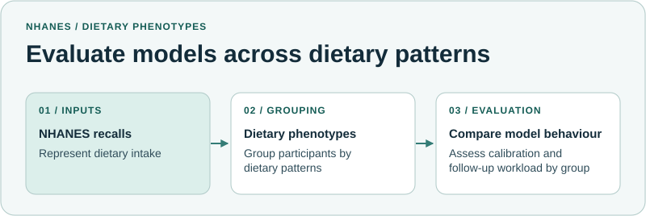

# Dietary Phenotyping

This study derives dietary-pattern groups and evaluates diet-only models across those groups for six cardiometabolic outcomes.

*Phenotype-Aware Evaluation of Diet-Only Models for Cardiometabolic Burden and Follow-Up Workload*

| | |
| --- | --- |
| **Research question** | How do cardiometabolic burden and model behaviour vary across dietary-pattern groups? |
| **Data** | Adult NHANES dietary recall data. The six outcomes are diabetes, hypertension, obesity, a simplified metabolic syndrome proxy, hyperlipidaemia and cardiovascular disease. |
| **Method** | Derive groups using k-means and compare diet-only models. Assess observed prevalence, calibration and follow-up alerts across groups under shared thresholds. |

## My contribution

I prepared the data, implemented the dietary clustering and prediction models, and evaluated model behaviour across dietary groups. My co-authors provided guidance on the study approach and reviewed the manuscript.

## What you can explore

The workflow diagram shows how dietary-pattern groups are derived and how models are evaluated across them.

[Back to the research portfolio](https://github.com/Shahin-Ghanbari#featured-research)
